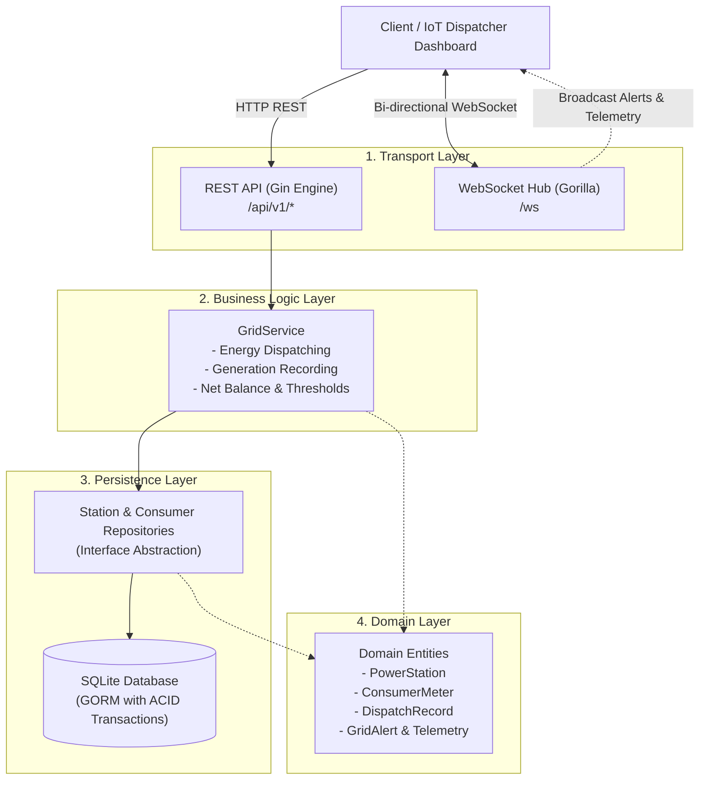

# ⚡ GoPower — Smart Grid Energy Dispatching & Telemetry Microservice

[](https://golang.org)
[](https://opensource.org/licenses/MIT)
[](https://www.docker.com/)
[](#system-architecture)

**GoPower** is a production-grade, highly-concurrent microservice written in **Go (Golang)** for smart energy grid distribution, real-time load dispatching, and live telemetry streaming. 

Built to simulate modern renewable microgrids (Solar, Wind, Battery Storage), GoPower balances energy generation with consumer demand, executes atomic dispatch transactions, and broadcasts critical telemetry and blackout alerts over real-time WebSockets without blocking the main event loops.

---

## 🏛 System Architecture

The project adheres to **Clean / Layered Architecture** principles, enforcing strict separation of concerns and dependency inversion:



---

## 🚀 Key Engineering Highlights

- **High-Concurrency Real-Time Hub:** Implemented an actor-style event loop using Go channels (`register`, `unregister`, `broadcast`) and `sync.RWMutex`. Employs non-blocking broadcasts to automatically drop slow or stalled clients without impacting overall grid throughput.
- **WebSocket Heartbeat (Ping/Pong):** Periodic ping/pong health-checks detect dead connections and clean up TCP socket descriptors.
- **ACID Atomic Transactions:** Energy dispatch transfers utilize database transactions (`tx.Commit` / `tx.Rollback`) ensuring station supply deductions and consumer demand additions remain strictly consistent.
- **Production-Ready Observability:** Structured JSON logging powered by Go's modern `log/slog` standard library.
- **Zero-Downtime Graceful Shutdown:** Traps OS signals (`SIGINT`, `SIGTERM`) to cleanly finish in-flight HTTP requests and gracefully close WebSocket clients.
- **Containerized & Minimalist:** Multi-stage `Dockerfile` producing a secure, non-root Alpine container image under **25MB**.
- **Automated CI Pipeline:** GitHub Actions workflow running `go vet` and concurrency tests with Go's **Race Detector (`-race`)**.

---

## 🛠 Tech Stack

- **Language:** Go (1.24+)
- **HTTP Framework:** [Gin Web Framework](https://github.com/gin-gonic/gin)
- **WebSocket Protocol:** [Gorilla WebSocket](https://github.com/gorilla/websocket)
- **ORM & Database:** [GORM](https://gorm.io/) with SQLite driver
- **Testing:** Standard Go testing with built-in `-race` detector
- **Containerization:** Docker & Docker Compose
- **CI/CD:** GitHub Actions

---

## 🚦 Getting Started

### Prerequisites

- Go 1.22 or higher installed.
- (Optional) Docker and Docker Compose installed.

### Option 1: Running Locally

```bash
# Clone the repository
git clone https://github.com/milad-ghaderi-dev/GoPower.git
cd GoPower

# Download dependencies
go mod download

# Run the server
go run ./cmd/server
```

The server will start listening on port `:8080`.

### Option 2: Running with Docker Compose

```bash
docker compose up --build
```

---

## 📡 API Reference

### Health Check
- `GET /health` — Verifies service readiness (Returns `200 OK`).

### Stations Management
- `POST /api/v1/stations` — Register a new power generation station.
- `GET /api/v1/stations` — List all registered stations (supports `?type=SOLAR|WIND|BATTERY`).
- `GET /api/v1/stations/:id` — Retrieve details for a specific station.

### Consumer Meters
- `POST /api/v1/consumers` — Register a new power consumer meter.
- `GET /api/v1/consumers` — List all consumers.
- `GET /api/v1/consumers/:id` — Retrieve consumer details.

### Energy Grid Operations
- `POST /api/v1/generation` — Record output energy generation for an active station.
- `POST /api/v1/dispatch` — Atomically dispatch energy from a station to a consumer.
- `GET /api/v1/grid/summary` — Get real-time net grid balance and system status (`NORMAL`, `WARNING`, `CRITICAL`).

### Real-Time WebSocket Endpoint
- `GET /ws` — Upgrades HTTP connection to bi-directional WebSocket stream.

#### Sample Telemetry Payload
```json
{
  "type": "TELEMETRY",
  "summary": {
    "total_stations": 4,
    "total_generation_mw": 320.5,
    "total_capacity_mw": 450.0,
    "total_consumers": 12,
    "total_demand_mw": 290.0,
    "net_balance_mw": 30.5,
    "status": "NORMAL"
  },
  "timestamp": "2026-10-21T12:00:00Z"
}
```

---

## 🧪 Testing & Verification

Run the test suite including race condition detection:

```bash
go test -v -race ./...
```

---

## 📄 License

This project is licensed under the MIT License — see the [LICENSE](LICENSE) file for details.